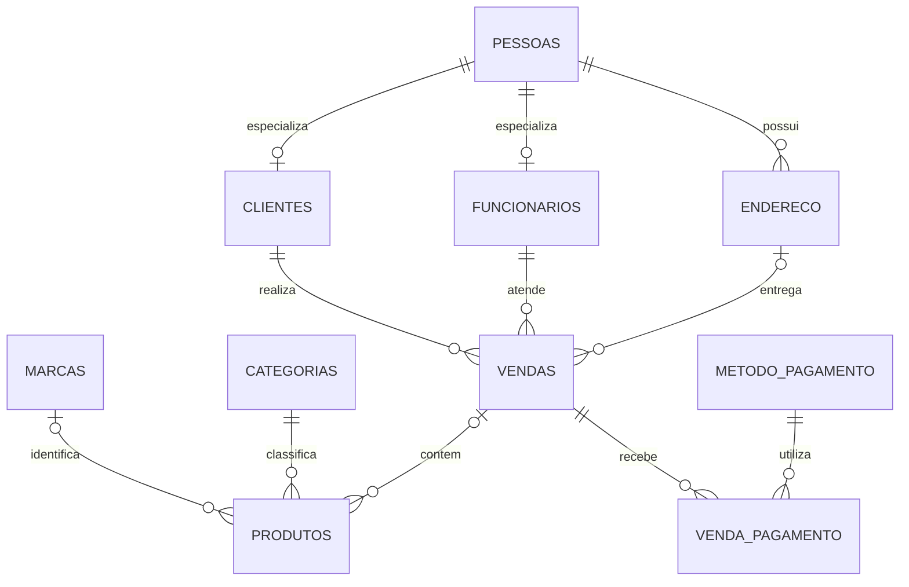

# Banco de dados

O banco relacional é SQL Server.  
O schema está em `src/main/resources/db/01_schema_sqlserver.sql`;  
regras executáveis do banco estão em `02_business_rules_sqlserver.sql`;  
o script `03_seed_database_sqlserver.sql` carrega dados estáticos para demonstração.  
A aplicação valida o schema existente e não cria as tabelas.

## Entidades e tabelas

| Tabela | Responsabilidade |
|---|---|
| `pessoas` | Dados comuns e CPF |
| `clientes` | Identifica pessoas que podem comprar |
| `funcionarios` | Identifica funcionários, e-mail, senha, salário e perfil |
| `endereco` | Endereços associados a pessoas |
| `marcas` | Marcas de produtos |
| `categorias` | Categorias de produtos |
| `produtos` | Itens de estoque, preço e vínculo opcional com venda |
| `vendas` | Cliente, funcionário, data, endereço de entrega, total e status |
| `metodo_pagamento` | Formas de pagamento e estado ativo |
| `venda_pagamento` | Pagamentos da venda por método |
| `configuracao_email` | Conta remetente usada para envio de e-mail |

## Relacionamentos

`clientes` e `funcionarios` usam CPF como chave e também como chave estrangeira para `pessoas`. O endereço tem vínculo opcional com a pessoa; a venda tem vínculo opcional com endereço. Produto pode não ter marca nem venda, mas precisa ter categoria.

## Domínios

- `funcionarios.perfil`: `0` administrador, `1` atendente.
- `vendas.status`: `0` aberta, `1` paga, `2` cancelada.
- `produtos.is_selled`: indica se o produto está vinculado a uma venda; triggers sincronizam esse valor com `cod_venda`.
- `metodo_pagamento.is_active`: indica se a forma pode ser usada em uma nova venda.
- Valores monetários usam `DECIMAL`; telefones e CPFs são armazenados como texto para preservar os dígitos.

Veja [DICIONARIO_DE_DADOS.md](DICIONARIO_DE_DADOS.md) para colunas e [RECURSOS_SQL.md](RECURSOS_SQL.md) para objetos do banco.
